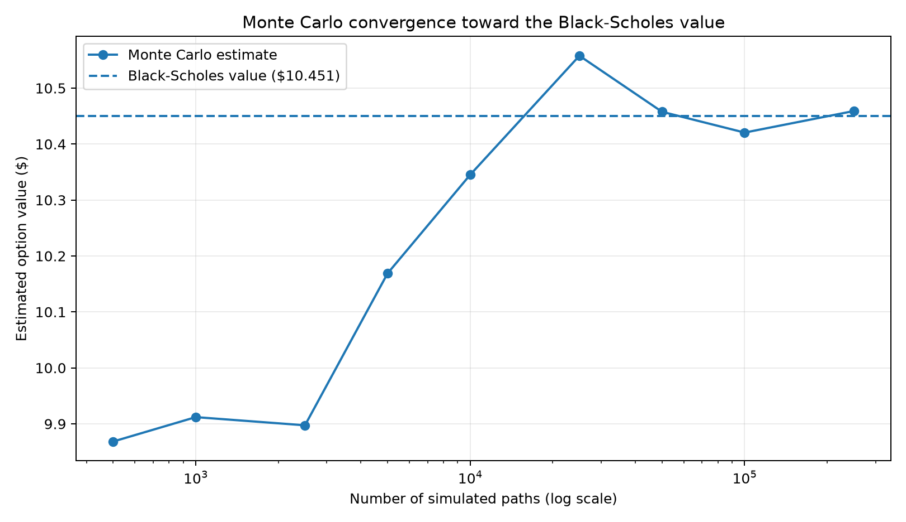

# Black-Scholes vs. Monte Carlo Option Pricing

An educational Python project comparing the Black-Scholes analytical value of a European option with a Monte Carlo estimate under risk-neutral geometric Brownian motion.

## What it demonstrates

- Implementing the Black-Scholes call and put formulas.
- Simulating terminal asset prices under risk-neutral geometric Brownian motion.
- Discounting simulated option payoffs and estimating a Monte Carlo standard error.
- Comparing simulation estimates with the analytical benchmark.
- Visualizing convergence as the number of simulated paths increases.
- Testing the known Black-Scholes example, put-call parity, and Monte Carlo consistency.

## Model assumptions and limitations

The example assumes a European option, constant volatility and continuously compounded risk-free rate, no transaction costs, and geometric Brownian motion. The dividend yield defaults to zero. These assumptions are simplified and do not reproduce the full complexity of real markets. This is an educational project, not an investment recommendation.

## Setup

Python 3.10 or newer is recommended.

```bash
python3 -m venv .venv
source .venv/bin/activate
python -m pip install -r requirements.txt
```

On Windows PowerShell, activate the environment with:

```powershell
.venv\Scripts\Activate.ps1
```

## Run the example

```bash
python run_analysis.py
```

The script prints the analytical price, Monte Carlo estimate, standard error, and absolute difference. It also saves `monte_carlo_convergence.png` in this directory and opens the chart.

## Run tests

```bash
pytest -q
```

## Suggested extensions

1. Compare calls and puts over several strikes and maturities.
2. Add an implied-volatility solver and compare the effect of volatility assumptions.
3. Explore variance reduction techniques such as antithetic variates or control variates, documenting the change in standard error.
4. Report results across several random seeds and discuss sampling variability.

## Reproducibility

The demonstration uses a fixed random seed so the illustrative output can be reproduced. Change the seed and number of paths to study how the Monte Carlo estimate varies.

## Example convergence chart

The following chart is generated by `run_analysis.py` using the fixed demonstration inputs and seed.


